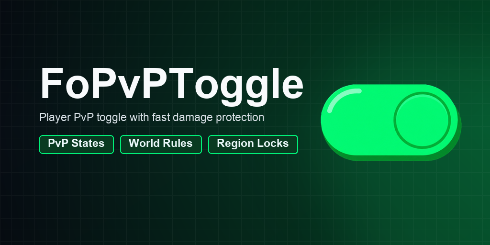
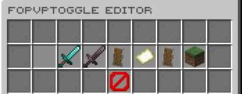
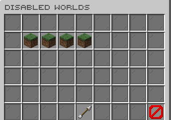
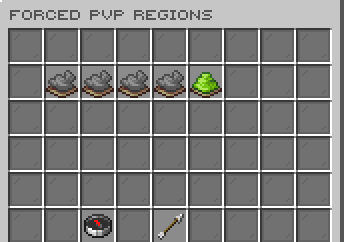

# FoPvPToggle

[](https://modrinth.com/plugin/fopvptoggle) [](https://modrinth.com/plugin/fopvptoggle/versions) [](https://discord.gg/kEF77QCfu7)

Personal PvP toggles with world, region, and damage controls.

*Developed by Carrotio.*

## Features

- Lets players control their personal PvP state.
- Applies fast damage protection and configurable toggle rules.
- Supports disabled worlds and WorldGuard forced-PvP regions.
- Includes optional PvE and FoBoss protection behavior.
- Provides administrator editing and reload controls.

## Download and dependencies

Download the latest compatible version from [Modrinth](https://modrinth.com/plugin/fopvptoggle). Check the [versions page](https://modrinth.com/plugin/fopvptoggle/versions) for supported Minecraft versions and server platforms.

- **Required:** None
- **Optional integrations:** `WorldGuard`, `PlaceholderAPI`

## Screenshots



*Configure PvP toggle behavior.*



*Manage disabled worlds.*



*Manage forced-PvP regions.*

## Support

For help or issue reports, join the [Carrotio Discord server](https://discord.gg/kEF77QCfu7).

<details>
<summary><strong>Commands and permissions</strong></summary>

### Commands

- `/fopvptoggle` — Toggle your PvP state Aliases: `/pvp`, `/pvptoggle`.
- `/fopvptoggleadmin <version|reload|editor>` — FoPvPToggle admin command Aliases: `/pvptoggleadmin`.

### Permissions

- `fopvptoggle.pvptoggle` — Toggle personal PvP state Default: `op`.
- `fopvptoggle.admin` — Access FoPvPToggle admin tools Default: `op`.

</details>

<details>
<summary><strong>PlaceholderAPI</strong></summary>

When PlaceholderAPI is installed, `%fopvptoggle_status%` returns `enabled` or `disabled`.

</details>

<details>
<summary><strong>Configuration</strong></summary>

- `config.yml` — Main behavior and feature settings.
- `messages.yml` — Player-facing messages and interface text.
- `sounds.yml` — Configurable interaction sounds.

Main config areas: `default-pvp-enabled`, `pvp-override`, `disabled-worlds`, `pve-protection`, `foboss-protection`, `worldguard`, `file-logging`.

</details>

<details>
<summary><strong>Developer API</strong></summary>

Compile against the matching jar (`provided` in Maven, `compileOnly` in Gradle); install it locally if needed. Declare `FoPvPToggle` in your plugin metadata (`softdepend` for an optional integration).

```xml
<dependency>
  <groupId>me.foesio</groupId>
  <artifactId>FoPvPToggle</artifactId>
  <version>1.8</version>
  <scope>provided</scope>
</dependency>
```

```java
import me.foesio.foPvPToggle.api.PvpToggleApi;
import me.foesio.foPvPToggle.api.event.PlayerPvpChangeRequestEvent;

PvpToggleApi api = Bukkit.getServicesManager().load(PvpToggleApi.class);
if (api != null) api.isPvpEnabled(player);

@EventHandler
public void onPlayerPvpChangeRequestEvent(PlayerPvpChangeRequestEvent event) {
    Bukkit.getLogger().info(event.getClass().getSimpleName());
}
```

**API methods** (overloads grouped):

- `PvpToggleApi`: `isPvpEnabled`, `isPvpAllowedByToggle`, `isPveProtected`, `storedPreference`, `requestPvpChange`, `forcePvp`, `releasePvpForce`.

**Other API types:** `PvpChangeCause`, `PvpChangeResult`.

**Events:** `PlayerPvpChangeRequestEvent`, `PlayerPvpPreferenceChangedEvent`.

[Browse API source](src/main/java/me/foesio/foPvPToggle/api) for signatures and event details.

</details>
